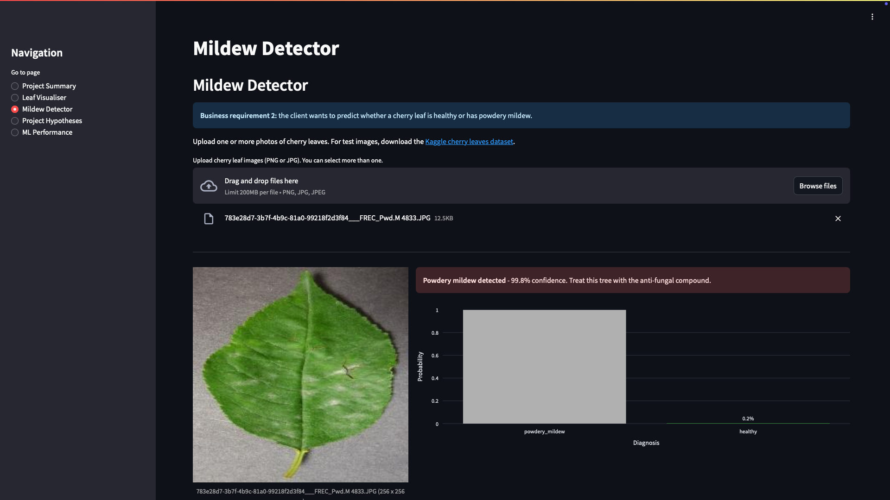

# Mildew Detector in Cherry Leaves

**Live dashboard:** [mildew-detector-mn.herokuapp.com](https://mildew-detector-mn-741688c18cc2.herokuapp.com)

The Mildew Detector is a machine learning dashboard that tells, from a single photo of a cherry leaf, whether the leaf is **healthy** or has **powdery mildew**. It was built for Farmy & Foods so that farm staff no longer need to inspect every cherry tree by hand.



## Table of contents

1. [Dataset Content](#dataset-content)
2. [Business Requirements](#business-requirements)
3. [Hypotheses and how to validate them](#hypotheses-and-how-to-validate-them)
4. [Rationale to map the business requirements to the Data Visualisations and ML tasks](#rationale-to-map-the-business-requirements-to-the-data-visualisations-and-ml-tasks)
5. [ML Business Case](#ml-business-case)
6. [Dashboard Design](#dashboard-design)
7. [CRISP-DM process](#crisp-dm-process)
8. [Project structure](#project-structure)
9. [Bugs](#bugs)
10. [Testing](#testing)
11. [Deployment](#deployment)
12. [Main data analysis and machine learning libraries](#main-data-analysis-and-machine-learning-libraries)
13. [Credits](#credits)

## Dataset Content

- The dataset is sourced from [Kaggle](https://www.kaggle.com/codeinstitute/cherry-leaves). It contains photos of cherry leaves provided by Farmy & Foods, taken from their own crops.
- It holds 4,208 images in two classes of equal size (2,104 each): **healthy** leaves and leaves with **powdery mildew**, a fungal disease that shows as white, powdery patches.
- The images are 256 x 256 pixel RGB photos. For this project they are resized to 128 x 128.
- The cherry crop is one of Farmy & Foods' most valuable products, and the company is concerned about supplying the market with compromised produce.

## Business Requirements

Farmy & Foods currently checks each cherry tree by hand. An employee spends about **30 minutes per tree** taking leaf samples and checking them visually; if mildew is found, a compound is applied in about 1 minute. With thousands of trees on several farms, this process does not scale.

The IT team proposed a machine learning system that detects mildew instantly from a leaf photo. If it succeeds, the same approach could be used for pest detection in other crops.

1. **Business requirement 1:** the client is interested in conducting a study to visually differentiate a healthy cherry leaf from one that contains powdery mildew.
2. **Business requirement 2:** the client is interested in predicting if a cherry leaf is healthy or contains powdery mildew.
3. **Business requirement 3:** deliver a dashboard that meets the above requirements.

## Hypotheses and how to validate them

| #   | Hypothesis                                                                                                   | Validation                                                                                                                  | Conclusion                                                                                                                                                                                                                                                                                                                                     |
| --- | ------------------------------------------------------------------------------------------------------------ | --------------------------------------------------------------------------------------------------------------------------- | ---------------------------------------------------------------------------------------------------------------------------------------------------------------------------------------------------------------------------------------------------------------------------------------------------------------------------------------------- |
| 1   | Leaves with powdery mildew show white, powdery marks that visually set them apart from healthy leaves.       | Image montages, average and variability images, and the difference between the average images.                              | **Confirmed.** The montages clearly show white or grey powdery patches on infected leaves, and the average infected leaf is a duller, greyer green than the average healthy leaf. The difference image shows the largest difference in the background (lighter in the healthy photos), a possible bias that should be checked on field photos. |
| 2   | Because the mildew is white, infected leaves have a higher mean brightness than healthy leaves.              | Mean pixel brightness per image, compared between the two classes with a Mann-Whitney U test (significance level α = 0.05). | **Rejected.** The difference is significant (p = 1.2 × 10⁻⁴¹), but healthy leaves are brighter (mean 0.539) than infected leaves (0.448). Much of this comes from the lighter background in the healthy photos, as well as the duller colour of infected leaves. The model should therefore be tested on field photos.                         |
| 3   | A convolutional neural network can classify unseen leaves as healthy or infected with at least 97% accuracy. | Accuracy on the test set, which is never used during training or model selection.                                           | **Confirmed.** The model reached 99.88% accuracy on 844 test images. All infected leaves were detected; one healthy leaf was wrongly flagged as mildew.                                                                                                                                                                                        |

**Next steps for the client:** roll the detector out to farm staff, keep a manual check for low-confidence predictions (below 80%), test the model on photos taken in normal field conditions to rule out the background bias found in hypotheses 1 and 2, and collect images from other crops to extend the system.

## Rationale to map the business requirements to the Data Visualisations and ML tasks

### Business requirement 1: Data visualisation

- As a client, I want to see the average and variability images for healthy and infected leaves, so that I can visually tell the two apart.
  - _Action:_ compute the mean and standard deviation image per label (notebook 02) and show them on the Leaf Visualiser page.
- As a client, I want to see the difference between an average healthy leaf and an average infected leaf, so that I can see where they differ.
  - _Action:_ plot the two average images and their difference (notebook 02); show on the Leaf Visualiser page.
- As a client, I want to see a montage of real healthy and infected leaves, so that I can recognise the disease myself.
  - _Action:_ create an image montage per label (notebook 02); show on the Leaf Visualiser page with a label selector.

### Business requirement 2: Classification (ML task)

- As a client, I want an ML model that predicts whether a leaf is healthy or has powdery mildew, so that I can decide quickly whether a tree needs treatment.
  - _Action:_ train a binary classification CNN on the labelled images (notebook 03).
- As a client, I want to upload one or more leaf photos and get a prediction with a confidence level, so that I can check trees in the field.
  - _Action:_ build the Mildew Detector page with an image uploader, prediction and probability chart.
- As a client, I want to download a report of the predictions, so that I can keep a record of which trees were checked.
  - _Action:_ show a results table with a CSV download button.

### Business requirement 3: Dashboard

- As a client, I want a dashboard with clear navigation, so that I can find each answer easily.
  - _Action:_ a Streamlit app with a sidebar menu and five pages, deployed on Heroku.

## ML Business Case

### Mildew detection - classification

- **Aim:** predict whether a cherry leaf is healthy or has powdery mildew, so that infected trees can be treated without a 30-minute manual inspection.
- **Learning method:** supervised learning; binary image classification with a convolutional neural network (CNN).
- **Ideal outcome:** farm staff photograph a leaf and get a reliable diagnosis in seconds, so the company can inspect far more trees in the same time.
- **Success metric:** accuracy of **97% or higher** on the test set (agreed with the client).
- **Failure:** the model performs below 97% on the test set, or it frequently labels infected leaves as healthy, which would let the disease spread.
- **Model output:** a label (healthy / powdery mildew) and the probability of that label. A probability of 0.5 or more for powdery mildew means the leaf is classed as infected.
- **Relevance for the user:** staff can treat infected trees straight away and skip healthy ones, saving time and protecting the quality of the crop.
- **Heuristics:** the current heuristic is a manual visual check of leaf samples, which takes about 30 minutes per tree and does not scale.
- **Training data:** the Kaggle cherry leaves dataset, split 70% train, 10% validation and 20% test. Features are the image pixels; the target is the label.
- **Result:** the final model reached **99.88% accuracy** on the test set (843 of 844 leaves correct), so the business case is met.

### Model iterations

Two versions of the CNN were trained and compared on the validation set (notebook 03):

| Version         | Augmentation               | Dropout | Epochs trained | Validation loss | Validation accuracy |
| --------------- | -------------------------- | ------- | -------------- | --------------- | ------------------- |
| A - baseline    | No                         | 0.2     | 4              | 0.0407          | 99.76%              |
| B - regularised | Yes (flip, rotation, zoom) | 0.5     | 5              | 0.0454          | 99.76%              |

Both versions use three Conv2D + MaxPooling blocks, a Dense layer of 128 neurons, the Adam optimiser and binary cross-entropy loss. Early stopping (patience 3, restoring the best weights) was used in both. Version A had the lower validation loss and was selected. The difference is very small; version B may cope better with photos taken in different conditions and is a good candidate to retest on field photos.

## Epics

The project was broken into five epics, each covered by the user stories above:

1. **Information gathering and data collection:** notebook 01 downloads the dataset from Kaggle and prepares it.
2. **Data visualisation, cleaning and preparation:** notebook 01 removes non-image files and splits the data; notebook 02 studies the images.
3. **Model training, optimisation and validation:** notebook 03 trains and compares two CNN versions and evaluates the chosen one on the test set.
4. **Dashboard planning, design and development:** the five-page Streamlit dashboard.
5. **Dashboard deployment and release:** deployed to Heroku.

## Ethical and privacy considerations

- The client provided the data under a non-disclosure agreement (NDA), so it should only be shared with professionals officially involved in the project. For this educational project, the dataset is the copy Code Institute published on Kaggle.
- The image data is not stored in this repository: it is in `.gitignore` and is downloaded by notebook 01 when needed.
- The images show only plant leaves and contain no personal data.

## Image size

The original images are 256 × 256 pixels. They were resized to 128 × 128, which keeps the mildew patches visible and makes the trained model 19.5 MB, well under GitHub's 100 MB file limit, so Git LFS was not needed. The model still met the 97% accuracy target.

## Dashboard Design

### Page 1: Project Summary

- The business problem and the time cost of the current manual process.
- A description of the dataset with a link to the source.
- The business requirements, and which page answers each one.
- A short guide to the menu.

### Page 2: Leaf Visualiser (business requirement 1)

- Checkbox 1: average and variability images for each label, with interpretation.
- Checkbox 2: the difference between the average healthy and average infected leaf, with interpretation.
- Checkbox 3: image montage with a selector for the label, with interpretation.

### Page 3: Mildew Detector (business requirement 2)

- A link to download sample images from Kaggle.
- An uploader that accepts one or more PNG/JPG images.
- For each image: the image, the diagnosis with its confidence, and an interactive bar chart of the class probabilities.
- A table of all results and a button to download it as a CSV report.

### Page 4: Project Hypotheses

- Each of the three hypotheses, how it was validated and the conclusion.
- Hypothesis 2 shows the brightness statistics, p-value and a box plot.
- Recommended next steps for the client.

### Page 5: ML Performance

- A clear statement at the top on whether the model met the 97% target.
- Interactive bar chart of the number of images per set and label.
- Comparison of the model versions trained.
- Learning curves (accuracy and loss) for training and validation.
- Test set results and confusion matrix.

## CRISP-DM process

1. **Business understanding:** the business requirements and ML business case above.
2. **Data understanding:** notebook 02 studies image size, averages, variability and montages.
3. **Data preparation:** notebook 01 downloads the data, removes non-image files and splits the sets; notebook 03 resizes images and applies augmentation.
4. **Modelling:** notebook 03 trains and compares two CNN versions.
5. **Evaluation:** notebook 03 checks the chosen model against the 97% target on the test set.
6. **Deployment:** the Streamlit dashboard on Heroku.

## Project structure

```
app.py                      # dashboard entry point
app_pages/                  # one file per dashboard page + the menu class
src/                        # helpers: loading outputs, predictions, evaluation
jupyter_notebooks/          # 01 data collection, 02 visualisation, 03 modelling
outputs/v1/                 # saved plots, model and evaluation for version 1
inputs/                     # image data (created by notebook 01, not in Git)
```

## Bugs

### Fixed bugs

| Bug                                                                                    | Cause                                                                                                           | Fix                                                                                                       |
| -------------------------------------------------------------------------------------- | --------------------------------------------------------------------------------------------------------------- | --------------------------------------------------------------------------------------------------------- |
| `pip install` failed on macOS with "No matching distribution found for tensorflow-cpu" | `tensorflow-cpu` is only published for Linux and Windows                                                        | Used environment markers in `requirements.txt`: `tensorflow-cpu` on Linux (Heroku), `tensorflow` on macOS |
| The prediction report crashed with `ImportError: pyarrow requires NumPy 2.0 or newer`  | Pip installed the latest pyarrow, but TensorFlow 2.18 requires NumPy below 2.1                                  | Pinned `pyarrow==18.1.0` in `requirements.txt`                                                            |
| Streamlit logged an Arrow serialisation error on the test results table                | The "Test set result" column mixed numbers and text                                                             | Formatted both values as text so the column has one data type                                             |
| The hypothesis 2 conclusion did not match the result                                   | The dashboard only handled "confirmed" or "not significant", not a significant result in the opposite direction | Added a third case that reports the hypothesis as rejected                                                |
| Flake8 reported lines longer than 79 characters                                        | Long strings and function calls                                                                                 | Split long strings and moved repeated logic into helper functions                                         |

### Unfixed bugs

- No known bugs. The app runs on a Heroku Eco dyno, so the first page load after a period of inactivity can take 20–30 seconds while the app wakes up.

## Testing

### Manual testing

| Feature                | Action                              | Expected result                                             | Result              |
| ---------------------- | ----------------------------------- | ----------------------------------------------------------- | ------------------- |
| Navigation             | Click each page in the sidebar      | The page loads                                              | Pass                |
| Leaf Visualiser        | Tick each checkbox                  | Plots and interpretations appear                            | Pass                |
| Montage selector       | Switch between labels               | Montage changes                                             | Pass                |
| Upload healthy images  | Upload 2 healthy test leaves        | "Healthy" with confidence and probability chart             | Pass (99.7%, 99.8%) |
| Upload infected images | Upload 2 powdery mildew test leaves | "Powdery mildew detected" with confidence and chart         | Pass (100%, 100%)   |
| Multiple uploads       | Upload several images at once       | One result per image and a report table                     | Pass                |
| Download report        | Click "Download report as CSV"      | CSV file downloads                                          | Pass                |
| Interactive charts     | Hover over Plotly charts            | Values shown on hover, zoom tools available                 | Pass                |
| Hypotheses page        | Open the page                       | Three hypotheses with conclusions and brightness statistics | Pass                |
| ML Performance         | Open the page                       | Success statement, charts, tables and confusion matrix      | Pass                |
| Deployed app           | Repeat the tests above on Heroku    | Same results as locally                                     | Pass                |

### Code validation

All Python files in `app.py`, `app_pages/` and `src/` pass Flake8 with no warnings (`flake8 app.py app_pages src --count` returns 0).

## Deployment

### Heroku

- The app is live at: https://mildew-detector-mn-741688c18cc2.herokuapp.com
- Python version is set in `runtime.txt`. Only the packages the dashboard needs are in `requirements.txt`; notebook-only packages are in `requirements-dev.txt` to keep the Heroku slug small.
- Large or unneeded files are excluded from Heroku with `.slugignore`.

Steps:

1. Log in to Heroku and create a new app.
2. Under the **Deploy** tab, choose **GitHub** and connect this repository.
3. Choose the `main` branch and click **Deploy Branch**.
4. When the build is complete, click **Open App**.

### Running locally

1. Clone the repository and create a virtual environment with Python 3.12.
2. `pip install -r requirements.txt -r requirements-dev.txt` (the correct TensorFlow package for your system is chosen automatically)
3. Put your `kaggle.json` in the repository root and run the notebooks in order (01, 02, 03).
4. `streamlit run app.py`

## Main data analysis and machine learning libraries

- **TensorFlow / Keras:** building, training and saving the CNN; loading images from folders; image augmentation.
- **NumPy:** image arrays, average and variability images.
- **pandas:** tables of image counts, training history and results.
- **Matplotlib / Seaborn:** static plots in the notebooks (averages, montages, learning curves, confusion matrix).
- **Plotly:** interactive charts on the dashboard.
- **scikit-learn:** confusion matrix and classification report.
- **SciPy:** Mann-Whitney U test for hypothesis 2.
- **Pillow:** opening and resizing images.
- **Streamlit:** the dashboard.
- **Kaggle API:** downloading the dataset.
- **joblib:** saving and loading small project files.

## Credits

### Content

- The project brief and dataset come from [Code Institute](https://codeinstitute.net/) and [Kaggle](https://www.kaggle.com/codeinstitute/cherry-leaves).
- The project structure follows the approach taught in the Code Institute Predictive Analytics module.
- Information about powdery mildew of cherry: [Michigan State University Extension](https://www.canr.msu.edu/ipm/diseases/powdery_mildew_of_cherry) and [Penn State Extension](https://extension.psu.edu/powdery-mildew-of-cherry-and-plum-in-home-fruit-plantings).

### Acknowledgements

- Thanks to my Code Institute mentor and the Student Care team for their support.
